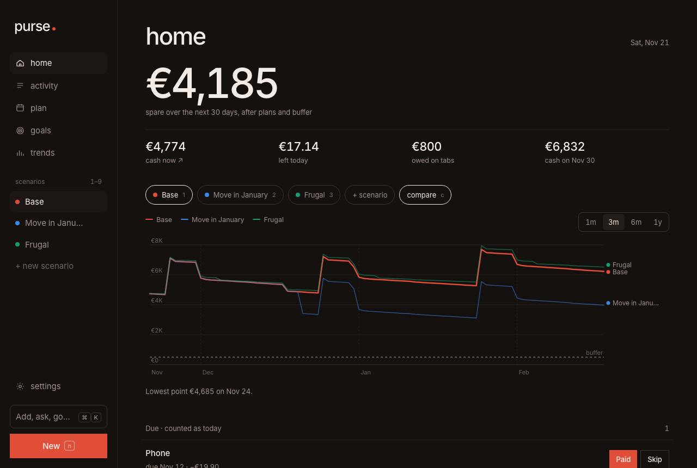
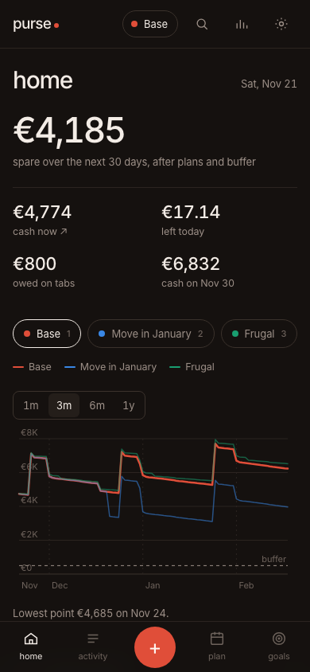

# purse

Keyboard-first budgeting that plans the money you **will** spend as carefully as what you **did** spend, then shows where each scenario leaves you.

**Live:** https://purse.knhdixh.com · auto-deploys from `main` via Workers Builds

<p> </p>

## What it does

| | |
|---|---|
| **Plan items** | *once* (a laptop on 20 Dec), *repeat* (rent on the 1st, salary on the 25th, gym ×12), *budget* (groceries 300 a month, treats 10 a day, eaten by matching spending), *tab* (a debt that grows: rent at 20 a day since 45 days ago, settled once or every month) |
| **Scenarios** | Base plan + overrides (turn items off, change amounts and dates) + items that only exist in a scenario. Compare them on one chart and in a table. |
| **Goals** | Target, date, already saved. Transfers and planned contributions move money out of spendable cash, into the goal. Shows needed per month and the projected date per scenario. |
| **Projection** | Daily cash, owed on tabs, money in goals and net worth for up to two years. Spare money (lowest cash in 30 days minus your buffer), left today, lowest point, buffer warnings. |
| **No double counting** | Projections start today. Bills you mark paid are linked to their date; unpaid ones from the last 35 days show as *due* and count as today. Budgets subtract what you already spent this period. |
| **Kinds and tags** | Every expense is fixed, everyday, spontaneous or planned (from its plan or category, overridable), plus free-form #tags. |
| **Trends** | Monthly spending by kind (actual + projected), daily spending calendar, categories against budgets, tags, top places, weekday rhythm, where the money sits, scenarios side by side. Every chart has hover details. |
| **AI (Gemini)** | Snap a receipt and get a prefilled transaction; ask questions ("how much on eating out in October?") or paste messy notes and confirm the proposed entries. The app does the maths and the model only reads it. |
| **Keyboard** | ⌘K / Ctrl-K or / command bar with quick add, ask and jump; n, p, u, b, g h/a/p/o/t/s, 1–9 and [ ] for scenarios, c compare, j/k, Enter, x, z undo, ? help. |
| **Mobile first** | Bottom tab bar with a centre add button, sheets that slide up and swipe down to close, 44px targets. |

### Quick add, in the command bar

```
12.5 coffee #treat                                spent today, tagged
8 lunch yesterday @eat !                          category, marked spontaneous
+2400 salary monthly on 25                        repeating income
rent 20/day since 45d ago settle monthly on 1st   a growing tab, paid off each month
groceries 300/month                               a budget (slash rate = budget)
laptop 1200 on 20.12                              future date = planned one-off
gym 30 monthly x12                                twelve payments
```

The parser remembers the names you've used before and fills in their category and tags. A preview shows how it read your input before you press Enter. Shift+Enter opens the full editor instead.

## How it works

- `public/engine.js`: the projection engine (occurrences with day-of-month clamping, tab accrual and settlements, budget periods, scenario overrides, goal ETAs). Pure functions, shared by the browser and the tests.
- `public/parse.js`: the quick-add parser.
- `src/worker.js`: JSON API on Cloudflare Workers + D1. Every row is scoped to the signed-in user, and validated against `src/schema.js`.
- `src/ai.js`: Gemini `generateContent` with a JSON response schema. The client sends a compact summary the engine computed.
- Sign-in with passkeys (no passwords, no email).
- Plain JS, no framework, no build step. Hand-rolled SVG charts.

The full design is in [docs/PLAN.md](docs/PLAN.md).

## Run locally

```bash
npm install
cp .dev.vars.example .dev.vars   # DEV_LOGIN=1 gives a local-only login at /auth/dev; add GEMINI_API_KEY to try AI
npm run dev                      # http://localhost:8787
npm test                         # engine, parser and API tests
```

Settings → *Load sample data* fills it with three months of example data.

## Deploy your own

```bash
npx wrangler d1 create purse             # put the database_id in wrangler.jsonc
npx wrangler secret put GEMINI_API_KEY   # optional; key from https://aistudio.google.com/apikey
npm run deploy                           # applies migrations, then deploys
```

Optional: `GEMINI_MODEL` (var, default `gemini-3.5-flash-lite`; `GEMINI_THINKING` sets the thinking level, default `minimal`), `AI_OWNER_USER_IDS` (comma-separated user ids with a higher daily AI limit).

## Limitations

- One balance pool (no separate accounts yet) and one currency per user.
- No bank import; entries come from typing, receipts or the AI.
- Gemini's free tier may use prompts to improve Google's products, and isn't offered for apps serving users in the EEA, UK or Switzerland. For anything beyond personal use, use a paid key.
- Receipt images are sent to Gemini and not stored.
